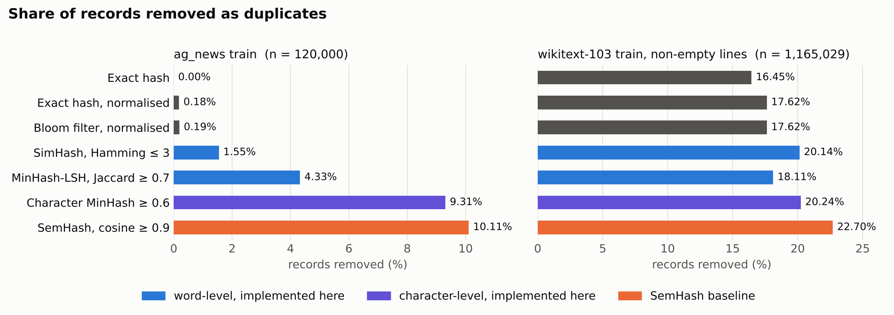
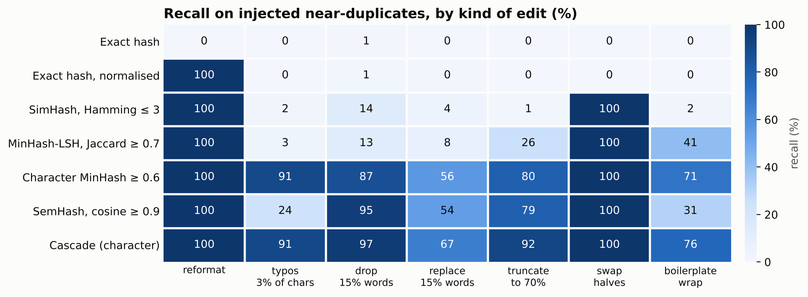
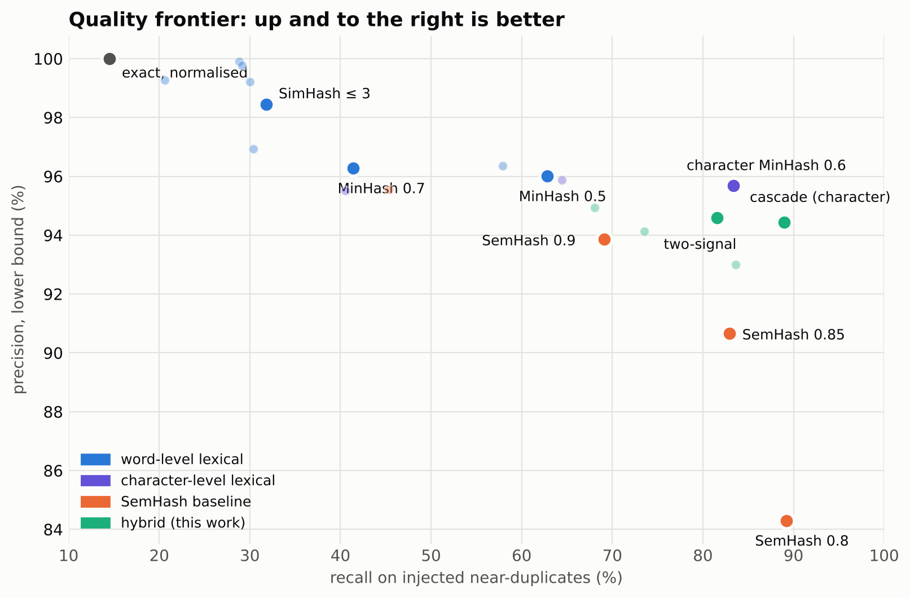
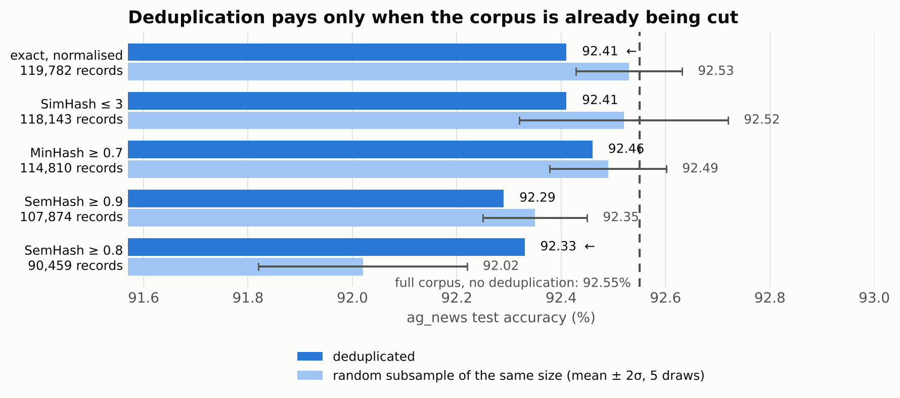

# Deduplicating ag_news and wikitext-103

**Experiment 1 — data deduplication.** Four deduplication techniques built from scratch,
benchmarked against [SemHash](https://github.com/MinishLab/semhash), the state-of-the-art
open-source semantic deduplicator.

The interesting question is not how much each method removes. It is which method is *right*,
and the datasets do not come with an answer key. Most of the work here is building ways to
find out.

---

## 1. Setup

| | ag_news (train) | wikitext-103 (train) |
|---|---|---|
| records | 120,000 news snippets | 1,801,350 lines, of which 636,321 are blank → **1,165,029** used |
| median length | 37 tokens | 86 tokens for substantive lines; headings are 1–3 tokens |
| exact duplicates | 0 | 191,616 (16.45%) |

wikitext is distributed as raw lines, so it is full of structural fragments: blank lines,
section headings such as `= = History = =`, discography rows, and sports tables. 16% of its
lines are byte-identical to an earlier line before any clever method is applied. ag_news has
no byte-identical pair at all, which already says the two corpora test different things.

## 2. Techniques implemented

All four are in `methods.py`, NumPy only, with no deduplication library involved.

| Technique | Detects | Mechanism |
|---|---|---|
| **Exact hashing** | identical text, raw or normalised | SHA-1 of the text, optionally after Unicode/case/punctuation folding |
| **Bloom filter** | the same, in bounded memory | `m = −n·ln p / ln²2` bits, `k = (m/n)·ln2` hash functions by double hashing |
| **MinHash + LSH** | near-duplicates by **Jaccard** of shingles | 128 permutations, banded 21 × 6; a shared band makes a candidate pair |
| **SimHash** | near-duplicates by **Hamming** distance | per-bit voting over token hashes; 6-block permutation index, exhaustive to 3 bits |
| *SemHash (baseline)* | **semantic** duplicates | `potion-base-8M` static embeddings, approximate-NN search over cosine |

Shingling, MinHash and SimHash are fully vectorised: all documents are concatenated into one
symbol stream, windows are taken over the whole array at once and then masked so none crosses a
document boundary. 1.16M documents are featurised in a single pass rather than a Python loop.

Every method keeps the first occurrence and attributes each removal to a record that is itself
kept, never to one already removed. Similarity is not transitive, so following chains would let
a document be deleted because of a document it does not resemble. SemHash's `select_canonicals`
makes the same choice, so the comparison is like-for-like.



## 3. How much each method removes

| method | ag_news removed | wikitext removed | wikitext time |
|---|---|---|---|
| Exact hash | 0 (0.00%) | 191,616 (16.45%) | 2.0 s |
| Exact, normalised | 218 (0.18%) | 205,298 (17.62%) | 20.2 s |
| Bloom filter | 231 (0.19%) | 205,330 (17.62%) | 23.1 s |
| SimHash ≤ 3 bits | 1,857 (1.55%) | 234,578 (20.14%) | 91.9 s |
| MinHash ≥ 0.7 | 5,190 (4.33%) | 210,976 (18.11%) | 131.8 s |
| Character MinHash ≥ 0.6 | 11,167 (9.31%) | 235,794 (20.24%) | 756.3 s |
| **SemHash ≥ 0.9** | **12,128 (10.11%)** | **264,399 (22.70%)** | 266.2 s |
| SemHash ≥ 0.8 | 29,544 (24.62%) | 395,554 (33.95%) | 422.1 s |

The Bloom filter reproduces normalised exact dedup with 13 false positives on ag_news and 32 on
wikitext — 0.016% of its decisions — using a 2.1 MB bit array instead of storing 1.16M digests.
The approximation behaves exactly as the theory predicts, which is the point of including it.

SemHash removes **2.3× more than MinHash on ag_news** and flags **18.5% of the ag_news test set**
as duplicating a training record, against MinHash's 7.8%. Those are very different claims about
the same corpus, and nothing above can say which is correct.

The character-shingle variant introduced in §5 lands within a point of SemHash on both corpora
from pure lexical matching — but note its wikitext time. Character shingles cost one shingle
per character instead of one per word, so 1.16M wiki lines generate roughly 340M shingles
against 134M for word shingles, and the 128-permutation loop runs over all of them. On long
documents the cheap lexical method becomes the **slowest** of the three, at 756 s against
SemHash's 266 s. It is cheap on short records and expensive on long ones, which is the
opposite of the usual assumption.

## 4. Does the extra removal find real duplicates? A ground-truth benchmark

Since the corpora carry no duplicate labels, I built an answer key: 20,000 ag_news records
(exact duplicates already removed, natural near-duplicates deliberately left in), plus 1,500
perturbed copies for each of seven kinds of edit — 10,500 known duplicates in total.

Precision is reported as a **lower bound**: the base is natural text, so some removals outside
the answer key may be genuine duplicates ag_news already contained. A second, independent error
signal avoids that ambiguity — ag_news is labelled, and a true duplicate of a World-news item
is also World news, so a removed pair whose two labels disagree is a near-certain mistake.



### Recall by kind of edit (%)

| method | reformat | typos | drop 15% | replace 15% | truncate 70% | swap halves | boilerplate |
|---|---|---|---|---|---|---|---|
| Exact, normalised | 100 | 0 | 1 | 0 | 0 | 0 | 0 |
| SimHash ≤ 3 | 100 | 2 | 14 | 4 | 1 | 100 | 2 |
| MinHash ≥ 0.7 | 100 | 3 | 13 | 8 | 26 | 100 | 41 |
| MinHash ≥ 0.5 | 100 | 15 | 36 | 26 | 84 | 100 | 80 |
| SemHash ≥ 0.9 | 100 | 24 | 95 | 54 | 80 | 100 | 31 |
| SemHash ≥ 0.8 | 99 | 66 | 97 | 87 | 95 | 100 | 80 |
| *Character MinHash ≥ 0.6* | *100* | *91* | *87* | *56* | *80* | *100* | *71* |

(The last row is the fix described in §5, shown here for comparison.)

Four things fall out of this table that the removal counts could never show.

**Word order is free.** Every method scores 100 on *swap halves*. Shingle sets, bit-vote
fingerprints and bag-of-words embeddings are all order-insensitive, so a reordered document is
invisible to all of them. A deduplicator that claims to catch "restructured" copies is claiming
something none of these techniques actually does.

**Deletion is where semantics wins.** Dropping 15% of the words costs MinHash almost everything
(13%) and costs SemHash almost nothing (95%). Removing words destroys the specific 3-word
shingles that MinHash depends on, while the meaning — and therefore the embedding — barely
moves. This is the single clearest justification for an embedding-based deduplicator.

**Boilerplate is where semantics loses.** A copy wrapped in scraped navigation text is found by
MinHash ≥ 0.5 (80%) but missed by SemHash ≥ 0.9 (31%). The added text leaves shingle overlap
largely intact but pulls the embedding away. For web-scale corpora, where boilerplate-wrapped
copies are the norm, this is a serious gap in the semantic method.

**Typos broke my own implementation.** Character-level corruption of 3% of characters left
MinHash at 3% and SimHash at 2%: one wrong letter destroys a whole word, and therefore every
word shingle containing it. That is a flaw in my design choice, not in the technique, so I
fixed it by shingling characters instead of words — see §5.

## 5. Three constructions of my own

The benchmark shows the two families failing in opposite directions: lexical methods miss
rewrites, the semantic method misses boilerplate and over-removes topic twins. Three
constructions of my own exploit that.

**Character-shingle MinHash.** Same LSH machinery, 5-character shingles instead of 3-word ones.
A typo damages a handful of character windows rather than destroying whole tokens. On a typo
pair the estimated Jaccard rises from 0.23 to 0.58, with unrelated text still at 0.00.

**Cascade** (`hybrid.py`). Exact → MinHash-LSH → embed only the survivors. The lexical pass is
roughly 20× cheaper per record than embedding, so paying it first shrinks the expensive stage.

**Two-signal** (`hybrid.py`). Remove a record only when the semantic score clears a high
threshold **and** the pair shares literal wording (estimated Jaccard ≥ 0.3). This targets
SemHash's dominant failure: two different stories about one topic sit close in embedding space
but share little wording.



### Quality frontier on the answer key

| method | recall | precision ≥ | F1 ≥ | cross-label removals |
|---|---|---|---|---|
| SimHash ≤ 3 | 0.318 | 0.984 | 0.481 | 3 |
| MinHash ≥ 0.7 | 0.414 | 0.963 | 0.579 | 13 |
| MinHash ≥ 0.5 | 0.628 | 0.960 | 0.759 | 26 |
| SemHash ≥ 0.9 | 0.691 | 0.939 | 0.796 | 47 |
| Cascade (word) | 0.736 | 0.941 | 0.826 | 44 |
| SemHash ≥ 0.85 | 0.830 | 0.907 | 0.867 | 88 |
| SemHash ≥ 0.8 | 0.892 | 0.843 | 0.867 | 203 |
| Two-signal (word, cos 0.85) | 0.816 | 0.946 | 0.876 | 55 |
| Two-signal (char, cos 0.85) | 0.836 | 0.930 | 0.880 | 67 |
| **Character MinHash ≥ 0.6** | 0.834 | 0.957 | 0.891 | 54 |
| **Cascade (char)** | **0.890** | **0.944** | **0.916** | 61 |

Two findings here matter more than the ranking.

**A purely lexical method beats the semantic baseline on this benchmark.** Character-shingle
MinHash alone reaches F1 0.891 against SemHash's best of 0.867, with no embedding model, no
neural network and no pretrained weights — just 5-character shingles through the same LSH index.
Switching the shingle unit from words to characters was worth more than everything else I tried.

**The cascade gets the best of both.** Character MinHash first, then the semantic pass on what
survives, reaches F1 0.916. It matches SemHash ≥ 0.8 on recall (0.890 vs 0.892) while making
**a third as many label-contradicting removals** (61 vs 203), because the cheap lexical pass
removes the easy cases before the embedding — which is the component that over-merges — ever
sees them.

A caveat that cuts against my own result: every injected duplicate is a *surface* perturbation
of a source text, so the benchmark rewards methods that track surface form. True paraphrase,
written independently with different vocabulary, is absent. The one column that approximates it
— replacing 15% of words with unrelated ones — is the column where SemHash ≥ 0.85 (77%) still
beats character MinHash ≥ 0.6 (56%). The lexical result is strong for the corruptions that
dominate real corpora; it is not a claim that embeddings are unnecessary in general.

## 6. What exactly does SemHash remove that MinHash does not?

57,454 wikitext lines and 7,145 ag_news records are removed by SemHash ≥ 0.9 and kept by
MinHash ≥ 0.7. Characterising them settles the question better than any aggregate.

| | wikitext disputed | wikitext agreed by both | wikitext kept by both |
|---|---|---|---|
| records | 57,454 | 206,996 | 896,599 |
| median length | **3 tokens** | 1 token | **86 tokens** |
| under 10 tokens | 70.8% | 92.7% | 17.2% |

On wikitext the disagreement is almost entirely about fragments. The lines SemHash removes
alone have a median length of three tokens, against 86 for the lines both methods keep. A
three-word section heading carries almost no information beyond its topic, so its embedding is
dominated by that topic and any two headings about adjacent subjects land close together.
Real examples from the run:

> removed `= = = Diamond Jubilee = = =` as a duplicate of `= = = Diamond = = =`
> removed `= = Campaign development = =` as a duplicate of `= = Campaign = =`

These are not duplicates. They are different sections of different articles.

On ag_news the disputed removals are full-length prose (median 39 tokens, the same as
everything else), and they split in two. 39.3% have strong lexical overlap (Jaccard ≥ 0.5) with
a kept record — genuine near-duplicates that MinHash's 0.7 threshold simply missed. 56.4% share
almost no wording (below 0.2), and those are a mixture of real paraphrase and real error:

> **Correctly merged** — `Stocks Sag as Colgate Warns, Oil Jumps` with
> `Stocks Slip After Colgate Warns`. Different headlines, same wire story.
>
> **Wrongly merged** — `Telekom Austria Plans to Buy Mobiltel for $1.5 Bln` with
> `Telekom Austria Wins Mobiltel Bid Option for $2.1 Bln`. Same companies, two different events
> at two different prices.

So SemHash's extra removals on ag_news are substantially real and its extra removals on
wikitext are substantially spurious. The corpus decides, which is why a single published
removal rate is not a quality claim.

## 7. Does any of it help downstream?

A deduplicator is only useful if the cleaned corpus trains a better model, so I trained a
TF-IDF + logistic-regression topic classifier on ag_news under each deduplication setting.

Deduplication also *shrinks* the training set, and less data costs accuracy on its own. Every
deduplicated run is therefore paired with a random subsample of exactly the same size, drawn
five times so the comparison carries an error bar.



| training set | size | deduplicated | random subsample | difference |
|---|---|---|---|---|
| full corpus | 120,000 | 92.55% | — | — |
| exact, normalised | 119,782 | 92.41% | 92.53% ± 0.05 | −0.12 (beyond 2σ) |
| SimHash ≤ 3 | 118,143 | 92.41% | 92.52% ± 0.10 | −0.11 (noise) |
| MinHash ≥ 0.7 | 114,810 | 92.46% | 92.49% ± 0.06 | −0.03 (noise) |
| SemHash ≥ 0.9 | 107,874 | 92.29% | 92.35% ± 0.05 | −0.06 (noise) |
| **SemHash ≥ 0.8** | **90,459** | **92.33%** | 92.02% ± 0.10 | **+0.31 (beyond 2σ)** |

**Deduplication is a budget allocator, not a free win.** At removal rates under 10% it changes
nothing a classifier can detect: every difference is inside the noise of simply drawing fewer
records. But when a quarter of the corpus has to go, dropping duplicates beats dropping at
random by 0.31 points — the only comparison here that clears two standard deviations in the
positive direction. The honest claim is conditional: deduplication earns its place when you are
already discarding data, which is exactly the pretraining situation it was designed for.

The one measurable *cost* appears at the other end. Removing 218 exact duplicates scored 0.12
points **below** removing 218 records at random, outside 2σ. Duplicated records act as mild
upweighting of whatever they say; strip them and that signal goes too.

### Train/test contamination does not inflate this benchmark

7.8% of the ag_news test set duplicates a training record according to MinHash ≥ 0.7, and 18.5%
according to SemHash ≥ 0.9. The standard worry is that a model scores inflated accuracy on
those records because it memorised them in training. It does not:

| test slice | MinHash-flagged | SemHash-flagged |
|---|---|---|
| accuracy on contaminated records | 92.10% | 92.88% |
| accuracy on clean records | 92.59% | 92.48% |

The contaminated slice is no easier than the clean one — for MinHash it is marginally harder.
A 120,000-example linear classifier over a 4-way topic task has no capacity to memorise
individual documents, so contamination buys it nothing. This result is specific to that
setting: it is evidence against assuming leakage inflates every benchmark, not evidence that
leakage is harmless for large generative models, where verbatim memorisation is the actual
mechanism of concern.

### Label agreement is a weak proxy for semantic methods

A true duplicate of a World-news item is also World news, so I measured how often removed pairs
share a label. Against a 25% random-pair baseline, every method scores 87–92%: exact 87.2%,
MinHash 90.7%, SimHash 92.2%, SemHash 91.3–91.6%. The proxy does not discriminate, and for a
clear reason — same-topic stories share a label by construction, which is precisely the case
where semantic deduplication errs. It is informative in one direction only: ag_news contains
byte-identical texts carrying contradicting labels, which is annotation noise rather than a
deduplication finding.

## 9. Conclusions

**1. Removal rate is not a quality metric.** SemHash removes 2.3× more of ag_news than MinHash
and 1.25× more of wikitext. On ag_news roughly 39% of that excess is lexically-verifiable
near-duplicates MinHash's threshold missed, and much of the rest is real paraphrase. On
wikitext the excess is mostly three-token section headings that merely share a topic. The same
published number means opposite things on the two corpora.

**2. Shingle unit mattered more than algorithm choice.** Moving MinHash from 3-word to
5-character shingles raised F1 from 0.579 to 0.891 — a bigger gain than switching from lexical
to semantic matching. It is the cheapest change in this report and the most valuable.

**3. Lexical first, semantic second.** The character cascade reaches F1 0.916 against SemHash's
best 0.867, with a third of its label-contradicting errors. Running the cheap, precise filter
before the expensive, permissive one removes the easy cases before the component that
over-merges can see them.

**4. Deduplication pays when you are already discarding data.** Under a 10% removal rate it
changes downstream accuracy by nothing measurable. At 24.6% it beats random subsampling of the
same size by 0.31 points, outside 2σ. That is the regime pretraining pipelines actually operate
in.

**5. Contamination did not inflate this benchmark.** 18.5% of the ag_news test set duplicates a
training record by SemHash's reckoning, and the model scores no better on those records than on
clean ones. Leakage is a memorisation problem, and a 4-way linear classifier has nothing to
memorise with.

## 10. Limitations

* **The answer key tests corruption, not paraphrase.** Every injected duplicate derives from a
  source text by surface edits. Independently written paraphrase — where embeddings should
  dominate — is unrepresented, so the lexical results are stronger here than they would be on a
  corpus of genuine rewrites.
* **Precision is a lower bound.** The benchmark base is natural ag_news, so some removals
  outside the answer key are real duplicates rather than errors. Cross-label removals bound the
  error from the other side, but neither number is an exact precision.
* **One downstream task, one model class.** TF-IDF with logistic regression on a 4-way topic
  task. The leakage conclusion in particular would need rechecking on a generative model.
* **Approximate indexes throughout.** LSH banding, the 6-block SimHash index and SemHash's
  approximate-NN search can each miss a pair. The SimHash index is provably exhaustive to 3
  bits and LSH recall was measured at >95% above Jaccard 0.8, but neither search is exact.
* **Thresholds are not tuned per corpus.** The same cosine 0.9 and Jaccard 0.7 are applied to
  120k news snippets and 1.16M wiki lines, which §6 shows to be very different problems.

## 11. Reproducing

```bash
pip install -r requirements.txt
python run_experiment.py     # removal rates on both corpora, and the SemHash baseline
python synthetic_eval.py     # precision / recall against injected duplicates
python downstream.py         # classifier accuracy, label agreement, train/test leakage
python control_variance.py   # error bars for the size-controlled comparison
python error_analysis.py     # what the methods disagree about
python scaling.py            # runtime and memory against corpus size
python make_figures.py       # figures
python -m pytest test_methods.py -q
```

`test_methods.py` checks each probabilistic structure against the exact quantity it
approximates: MinHash against true Jaccard on the same shingle sets, the LSH and SimHash
indexes against brute-force search, and the Bloom filter against a Python set.
